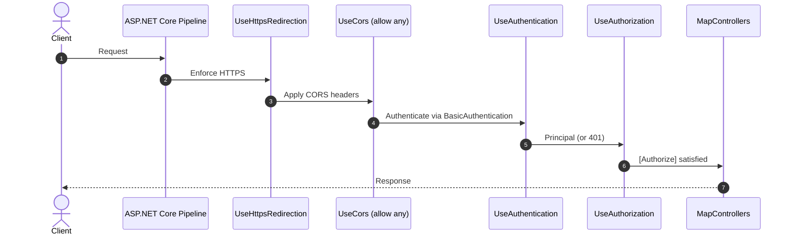
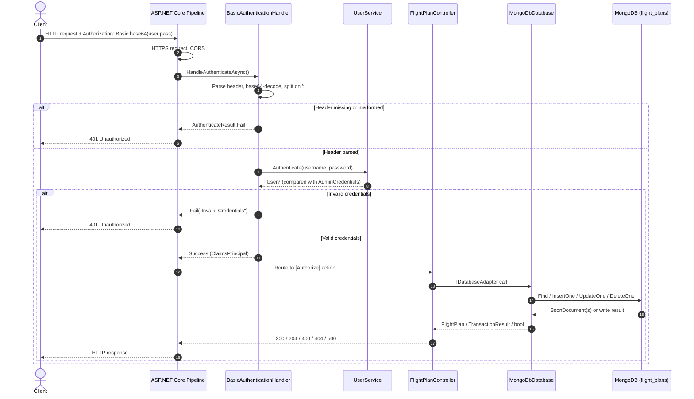
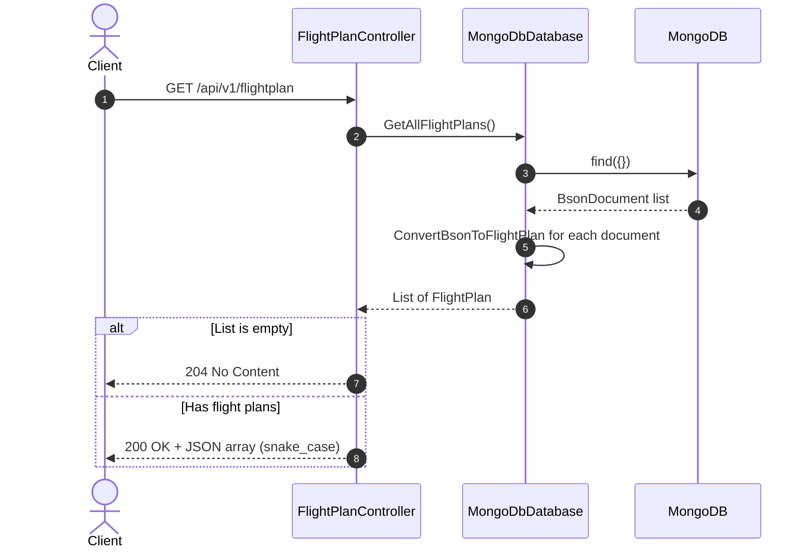
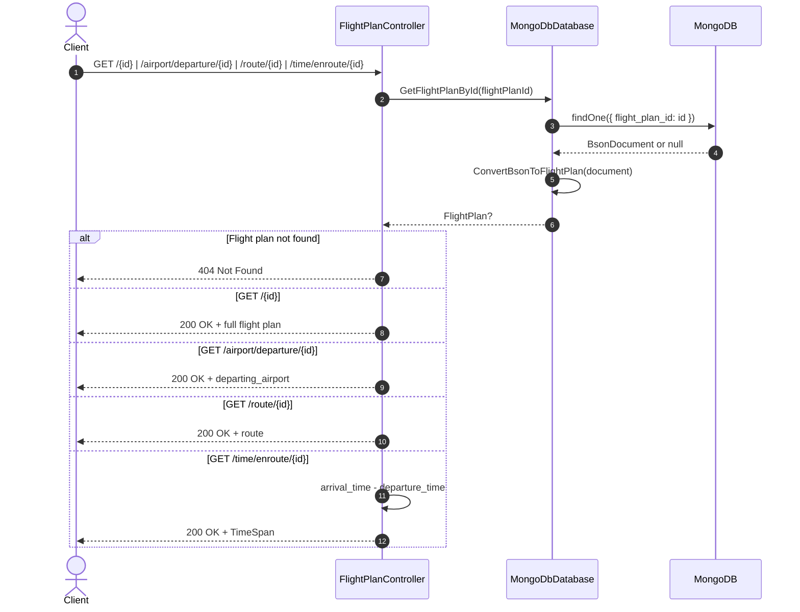
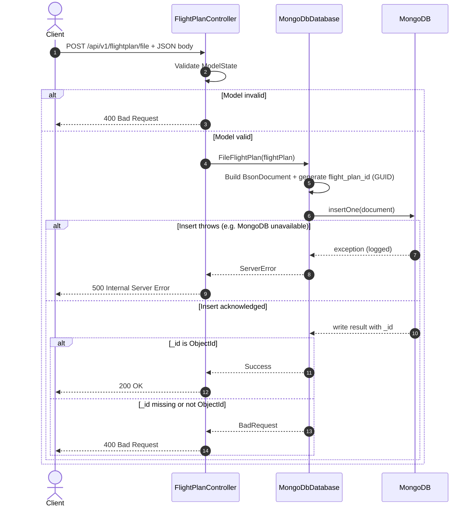
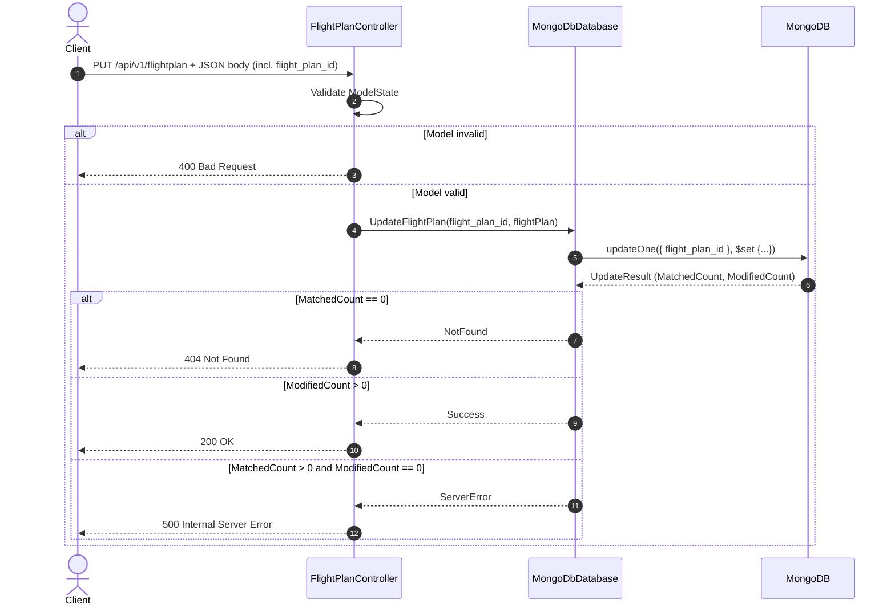
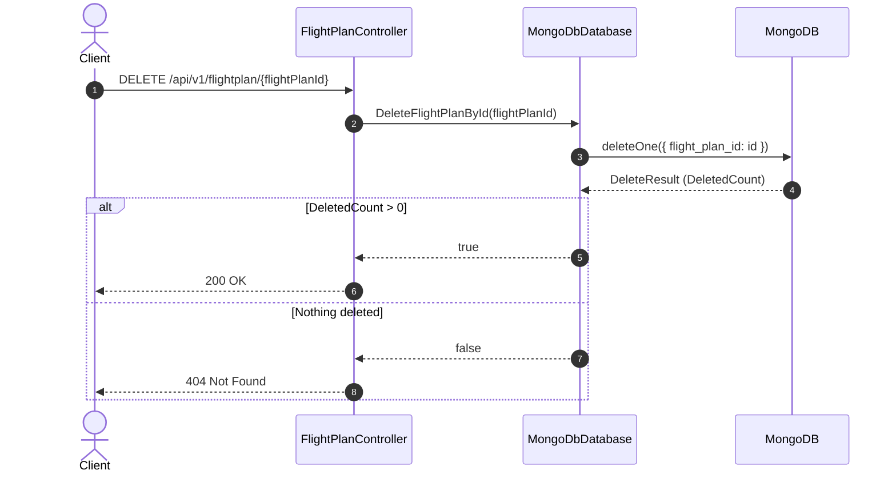

# Application Flow — Sequence Diagrams

Request flows through `BasicAuthenticationHandler` → `FlightPlanController` → `MongoDbDatabase` → MongoDB, as wired in `Program.cs`.

## Middleware pipeline

Order matters: HTTPS redirection and CORS run before authentication, and authorization runs before the controller.

## Authenticated request (full flow)

## GET `/api/v1/flightplan` (list)

## GET `/api/v1/flightplan/{flightPlanId}` and derived views

The departure-airport, route, and time-enroute endpoints all load the full plan first, then return one derived value.

## POST `/api/v1/flightplan/file`

`flight_plan_id` is generated server-side with `Guid.NewGuid()`. Success is only reported when the inserted document receives an `_id` of type `ObjectId`.

## PUT `/api/v1/flightplan`

## DELETE `/api/v1/flightplan/{flightPlanId}`

## Notes

- All routes are under `/api/v1/flightplan` and carry `[Authorize]`; failures surface as `401 Unauthorized` from the authentication middleware.
- JSON payloads use snake_case (`Models/FlightPlan.cs`), while MongoDB field names are mapped explicitly in `MongoDbDatabase.ConvertBsonToFlightPlan`, `FileFlightPlan`, and `UpdateFlightPlan`.
- There is no repository layer despite older docs: the controller depends directly on `IDatabaseAdapter` (`MongoDbDatabase`), which is registered scoped in `Program.cs`.
